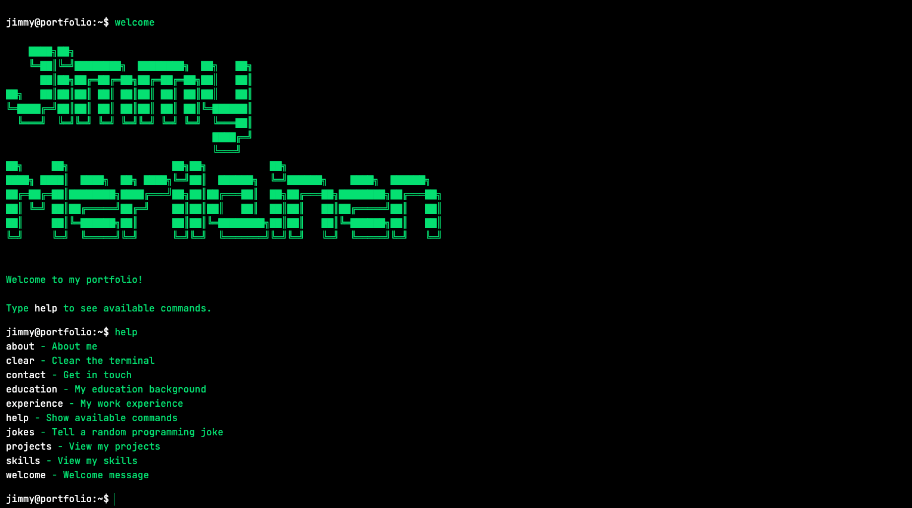

# Terminal Portfolio

A terminal-inspired personal portfolio built with SvelteKit and TypeScript. Explore my experience, education, skills and projects through an interactive terminal interface.

## Preview



## Live Demo

[View Portfolio](https://jimmymerilainen.github.io/terminal-portfolio/)

## Features

- Interactive terminal interface
- Custom terminal commands
- Command history with keyboard navigation
- Case-insensitive commands
- Responsive ASCII art for desktop and mobile
- Random programming jokes with an animated countdown
- Responsive design for desktop and mobile
- Automated deployment to GitHub Pages

## Tech Stack

- **Framework:** SvelteKit
- **Language:** TypeScript
- **Styling:** Tailwind CSS
- **Testing:** Vitest
- **Build Tool:** Vite
- **CI/CD:** GitHub Actions
- **Hosting:** GitHub Pages

## Getting Started

### Prerequisites

Make sure you have the following installed:

- [Node.js](https://nodejs.org/)
- npm (included with Node.js)

### Installation

1. Clone the repository:

   ```bash
   git clone https://github.com/jimmymerilainen/terminal-portfolio.git
   ```

2. Navigate to the project directory:

   ```bash
   cd terminal-portfolio
   ```

3. Install dependencies:

   ```bash
   npm install
   ```

### Development

Start the development server:

```bash
npm run dev
```

To automatically open the application in your browser:

```bash
npm run dev -- --open
```

## Testing & Validation

Run the following commands to check the project:

```bash
npm run check
npm run lint
```

## Production Build

Create a production build:

```bash
npm run build
```

Preview the production build locally:

```bash
npm run preview
```

## Deployment

The project is deployed to GitHub Pages using GitHub Actions.

Every push to the `main` branch automatically triggers a workflow that:

1. Installs dependencies.
2. Builds the application.
3. Uploads the static build.
4. Deploys the site to GitHub Pages.

## Author

**Jimmy**

- GitHub: [Jimmy](https://github.com/jimmyMerilainen)
- Portfolio: [View Portfolio](https://jimmymerilainen.github.io/terminal-portfolio/)
